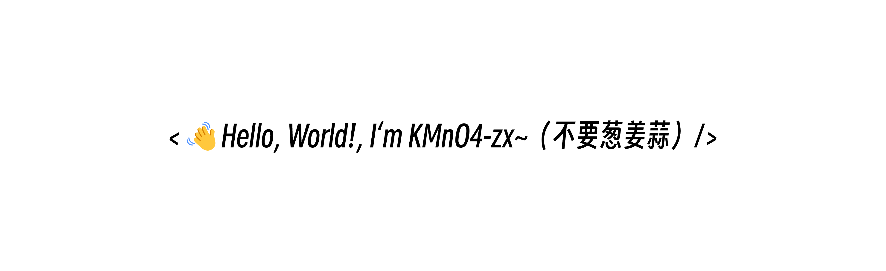

  

   
  <i>靡不有初，鲜克有终。</i>

  
  
  
  
  
   
  
  
  
  

## About Me

- 🔬 Open-source developer and researcher focused on **Agent RL**, **LLM post-training**, and **AI agents**.
- 🌟 Developer and maintainer of open-source projects with **100,000+ GitHub stars** in total.
- 🧪 Researcher at **Emotion Machine Lab**, also working on growth and developer/community operations.
- 🌐 Homepage: **[kmno4-zx.github.io/KMnO4-zx](https://kmno4-zx.github.io/KMnO4-zx/)**.
- 📫 Reach me at **kmno4-song@foxmail.com**.

  <picture>
    <source media="(prefers-color-scheme: dark)" srcset="https://raw.githubusercontent.com/KMnO4-zx/KMnO4-zx/output/github-contribution-grid-snake-dark.svg">
    <source media="(prefers-color-scheme: light)" srcset="https://raw.githubusercontent.com/KMnO4-zx/KMnO4-zx/output/github-contribution-grid-snake.svg">
    
  </picture>

## Research Interests

- **Agent RL** — reinforcement learning for reasoning, tool use, and multi-turn agents.
- **LLM Post-training** — alignment, feedback mechanisms, and efficient post-training methods.
- **AI Agents** — agentic systems, research agents, and evaluation.

## Open Source Experience

### Maintainer & Creator

- [**Happy-LLM**](https://github.com/datawhalechina/happy-llm) — A from-scratch guide to LLM fundamentals and implementation. 
- [**self-llm**](https://github.com/datawhalechina/self-llm) — A practical guide to deploying and fine-tuning open-source LLMs. 
- [**agentic-rl-lab**](https://github.com/datawhalechina/agentic-rl-lab) — Hands-on reproductions of RL algorithms for LLM agents, including GRPO, GSPO, DAPO, and Search-R1. 
- [**tiny-universe**](https://github.com/datawhalechina/tiny-universe) — Hands-on implementations of RAG, agents, evaluation, and other LLM systems. 
- [**paper-insight**](https://github.com/KMnO4-zx/paper-insight) — An AI-powered platform for paper analysis and research workflows. 
- [**huanhuan-chat**](https://github.com/KMnO4-zx/huanhuan-chat) — A ChatGLM-based character chatbot fine-tuned on dialogue from *Empresses in the Palace*. 
- [**AMchat**](https://github.com/AXYZdong/AMchat) — An LLM-powered assistant for advanced mathematics. 
- [**d2l-ai-solutions-manual**](https://github.com/datawhalechina/d2l-ai-solutions-manual) — Community solutions for *Dive into Deep Learning* exercises. 

### Contributor

- [**prompt-engineering-for-developers**](https://github.com/datawhalechina/prompt-engineering-for-developers) — Chinese learning materials for Andrew Ng's prompt engineering courses. 
- [**InternLM Tutorial**](https://github.com/InternLM/tutorial) — Hands-on tutorials and demos for the InternLM ecosystem. 
- [**Tianji**](https://github.com/SocialAI-tianji/Tianji) — An open-source system for building socially intelligent AI agents. 

## Research & Work Experience

### Emotion Machine Lab — Researcher & Growth Operations

*Present*

- Conduct research on Agent RL, LLM post-training, and agentic systems.
- Work across developer growth, community operations, and the open-source ecosystem.

### Westlake University, AGI Lab — Research Assistant

- Researched multimodal model behavior and safety with Prof. Chi Zhang; first-authored [*Hard to Read, Easy to Jailbreak*](https://aclanthology.org/2026.findings-acl.983/) at Findings of ACL 2026.

### Yunqi Academy of Engineering — Research Assistant

*Jun 2024 – Aug 2024*

- Studied LLM applications in urban governance and co-authored [*What can LLM tell us about cities?*](https://arxiv.org/abs/2411.16791).

## Selected Publications

- **[Hard to Read, Easy to Jailbreak: How Visual Degradation Bypasses MLLM Safety Alignment](https://aclanthology.org/2026.findings-acl.983/)** — Findings of ACL 2026. *(First author)*
- **[What can LLM tell us about cities?](https://arxiv.org/abs/2411.16791)** — arXiv, 2024.
- **[A Raster Voronoi Diagram Generating Algorithm Using Edge Attribution and Bilateral Scanning](https://ch.whu.edu.cn/article/doi/10.13203/j.whugis20220110)** — *Geomatics and Information Science of Wuhan University*, 2024.

## GitHub Stats

  

